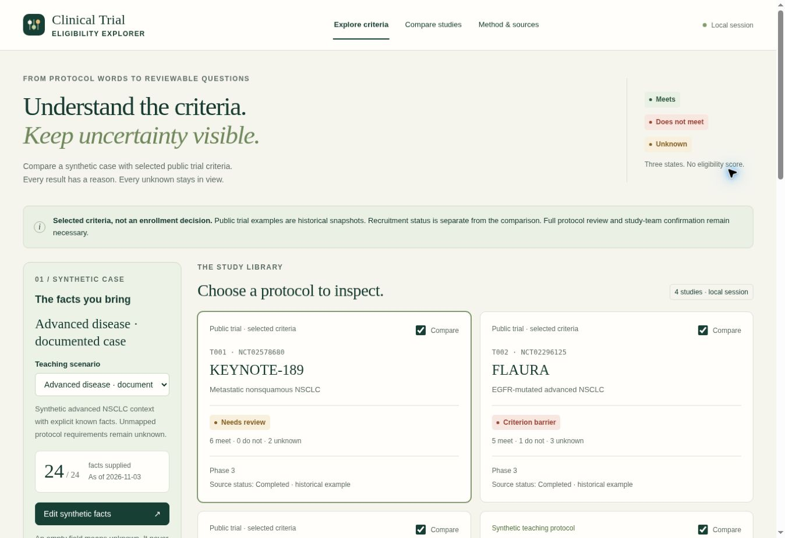

# Clinical Trial Eligibility Explorer

A browser-local workspace for comparing synthetic cases with selected clinical-trial criteria. Each criterion produces **meets**, **does not meet**, or **unknown**, with a visible explanation of the rule and the evidence still needed.

**[Open the demo](https://ysm19990103.github.io/clinical-trial-eligibility-explorer/)** · [Methodology](docs/methodology.md) · [JSON formats](docs/formats.md) · [Architecture](docs/architecture.md) · [Security and privacy](SECURITY.md) · [Quality review](docs/quality-review.md) · [FLAURA mapping audit](docs/flaura-mapping-audit.md)

This is an educational portfolio project. It does not determine eligibility, recommend treatment, or enroll participants. The public examples are historical teaching comparisons; a study's recruitment status is separate from its criteria results. Use synthetic cases only.



## Explore a review

- Start with a documented synthetic case, an incomplete referral, conflicting criteria, or a laboratory-evidence scenario.
- Compare studies, inspect individual inclusion and exclusion criteria, and expand the reasoning behind combined rules.
- Review missing facts, stale evidence, unit mismatches, and manual protocol requirements without treating uncertainty as a pass.
- Follow selected criteria to their public sources. Source dates and review dates are identified separately.
- Import a local structured case, a study pack, or a ClinicalTrials.gov API v2 JSON export. The app does not query a registry or transmit case data.
- Export a JSON, CSV, or standalone HTML review that omits raw case values and imported free text.

The built-in library contains selected criteria from **KEYNOTE-189, FLAURA, and ADAURA**, plus a clearly fictional laboratory sandbox. Every public-trial template retains an unassessed-protocol item. The sandbox demonstrates rule composition, evidence age, and unit handling; its thresholds are not clinical recommendations.

## Run locally

Use Node.js 22 or later. There are no third-party npm or runtime dependencies, and no package installation is needed.

```sh
npm test
npm run build
npm run check
npm run dev
```

Open the URL printed by the development server. The build writes static assets to `dist/`, with content-addressed JavaScript modules and CSS. GitHub Actions runs the tests, build, and source/build checks before publishing to GitHub Pages.

Command-line review uses the same parser, evaluator, and report code:

```sh
node scripts/audit.mjs synthetic-case.json --format json
node scripts/audit.mjs synthetic-case.json --studies teaching-pack.json --format csv > review.csv
node scripts/audit.mjs synthetic-case.json --format html > review.html
cat synthetic-case.json | npm run --silent audit -- --format json
```

Without a case filename, the CLI reads standard input. Without `--studies`, it uses the built-in studies. The optional studies file can be a structured study pack or a ClinicalTrials.gov v2 JSON export. Supported output formats are `json`, `csv`, and `html`. Exit codes are:

| Code | Meaning |
| --- | --- |
| `0` | No evaluated study has a selected-criterion barrier; unknown results may remain |
| `1` | At least one evaluated study has a selected-criterion barrier |
| `2` | Input, file-reading, or command-line usage failure |

A zero exit code does not establish eligibility. Run `npm run coverage` for the test coverage report. `npm run check` performs JavaScript syntax checks and scans for selected credential patterns, contact emails, prohibited data-file formats, and application network/persistence APIs. This is a heuristic safeguard, not a comprehensive security audit.

## How results should be read

An inclusion criterion meets its selected rule when the predicate is true. An exclusion criterion meets its selected rule when the exclusion predicate is false. Unknown evidence stays unknown through both paths. The evaluator supports explicit `all`, `any`, and `not` groups; it does not infer rules from clinical prose.

A study with any conflicting selected criterion is labeled as having a criterion barrier. If no barrier is found but any requirement is unassessed, it needs review. Even a fictional case that meets every modeled check has only met those selected checks. Full eligibility still depends on the applicable protocol, amendments, assessment timing, site interpretation, consent, and investigator review.

ClinicalTrials.gov import is deliberately conservative: supported structured age-in-years and sex fields may be mapped, while free-text eligibility remains a manual requirement. Text is displayed as source material rather than interpreted as executable rules. See [the methodology](docs/methodology.md) for details and limitations, and [JSON formats](docs/formats.md) for validated synthetic examples and the supported schema.

## Privacy and source handling

The application has no backend, patient database, account, API key, telemetry, or case persistence. Inputs remain in browser memory. It does not collect names, contact details, record identifiers, or dates of birth. Reports use local study and criterion aliases and omit raw case facts and imported source text. They retain the chosen assessment date and ruleset version.

These controls reduce exposure; they do not certify de-identification. The case editor displays the synthetic values entered by the user, and imported study text is visible in the source pane. Structural findings can still disclose information. Browser extensions, device security, clipboard history, downloaded files, and normal static-host request logs are outside the application's boundary. See [SECURITY.md](SECURITY.md).

## Engineering evidence

The project separates bounded parsing, schema validation, three-state evaluation, registry adaptation, reporting, and presentation. The 101 automated tests cover rule truth tables, exclusion polarity, uncertainty propagation, numerical and date boundaries, malformed inputs, source handling, and output privacy canaries, including 13 regressions for the FLAURA refinement and related-template boundaries. Public criteria are traceable to sources and kept distinct from fictional demonstration rules.

These choices make the project useful for demonstrating clinical research literacy, healthcare data modeling, defensive input handling, and explainable software behavior.

## Contributing

Use only synthetic reproductions. Do not attach patient records, private registry exports, credentials, identifiable screenshots, or personal contact details to issues or pull requests. When changing a rule, identify its source and context, preserve protocol qualifications, and add a regression test. Keep recruitment status and criteria logic separate.

Licensed under the [MIT License](LICENSE). Trial and registry names identify their public sources; this independent project is not affiliated with or endorsed by trial sponsors, NCI, or ClinicalTrials.gov.
